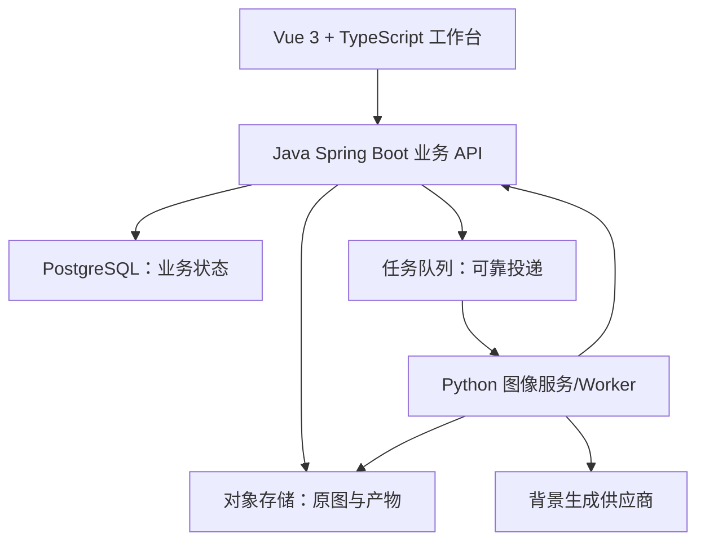

# AI 母婴商品图工作台：产品设计与开发方案

**状态**：需求基线 v0.2（决定同步，不代表实现完成）｜**日期**：2026-09-26｜**面向**：产品、设计、前端、Java、Python、测试、运维

## 1. 目标、事实和范围

目标：让业务人员使用单张商品白底图，为拼多多经营场景制作可预览、可调整、可下载的商品图，减少手工排版和场景搭建时间。产品为公司内部工作台。预计每天输出 150 张，三分钟为待压测的等待目标；当前供应商选定 OpenRouter。预算和平台图片规则仍待核实，不承诺无限并发下达标。决定依据见 04 的 ADR-20260926。

| ID | 已确认的要求 | 可验证的交付 |
| --- | --- | --- |
| PRD-G01 | （ADR-20260929 修订）AI 以商品图为参考生成整图，尽量保持商品一致 | 提示词约束商品外形/颜色/Logo/文字/数量不变；结果待人工审核并可与原图对照；原图保留，记录输入图哈希与生成参数 |
| PRD-G02 | 输入为单张商品白底图 | 上传、预览与校验（ADR-20260929 起不做抠图） |
| PRD-G03 | 三种需求是三个独立功能 | 赠品图、场景图、卖点图各自可从首页单独进入并完成任务 |
| PRD-G04 | 仅生成，不发布 | 结果预览和下载，无拼多多账号绑定与发布操作 |
| PRD-G05 | 面向母婴用品 | 界面柔和、清晰、可信；视觉色板为建议而非品牌标准 |
| PRD-G06 | 使用 Java + Python 技术栈 | Java 业务服务与 Python 图像服务职责分离 |
| PRD-G07 | 网页可配置画布比例、像素尺寸、JPEG/PNG 和生成数量，默认 3 张（ADR-20260929 改为默认 1 张、最多 4 张） | 预览与导出使用同一配置快照；可选数量上限、卖点分配待确认；平台预设标为未核实 |
| PRD-G08 | 生产使用本地账号 | 独立的生产账号管理、会话和权限测试；不得直接解除 dev-local 限制代替实现 |
| PRD-G09 | 图片默认永久保存，生产者及管理员可删除，不做备份恢复 | 删除授权、一致性与审计可验证；无自动过期承诺；明确不可恢复 |
| PRD-G10 | 日输出预计 150 张，等待目标三分钟，不设业务峰值并发配额 | 在供应商配额和机器能力内排队执行，记录实测工作负载、等待与处理耗时 |
| PRD-G11 | 当前 OpenRouter，可扩展官方/第三方/本地接口适配 | 背景专用输入隔离；真实接入与契约/模拟验证分开记录 |
| PRD-S01 | 赠品独立图；默认右下、可调位置；无角标；比例可自行确认（ADR-20261008-G：页面改为“赠品主图”，不再输入文字，文字在卖点主图中用“保持原图”添加） | 两图上传/预览、赠品位置选项（默认右下，由模型摆放）、文字输入（程序叠加、生成后可调）与导出 |
| PRD-S02 | 场景预设 + 自定义输入；风格后续可自定义 | 选择场景、输入描述、以商品图为参考生成场景图（默认 1 张）、生成后查看、失败重试 |
| PRD-S03 | 卖点由业务人工输入（ADR-20261008-G：每条卖点一张，共用标题 + 该卖点；风格可选“保持原图”，不调用模型直接叠字） | 以商品图为参考按所选风格生成，每个风格一张（默认 1 张，ADR-20260928/29）；卖点文字由程序按原文叠加，可编辑后重排 |

范围内：简易账号权限、素材管理、三入口、模板配置、异步生成、历史记录、图片预览和下载、失败说明。范围外：自动发布、拼多多 API 对接、AI 杜撰卖点、真实比例强制校正、通用工作流编辑器、自研基础模型、大规模批量 SKU。后续若要求把场景、赠品和卖点叠加，需单独评审需求。

## 2. 用户角色与操作路径

| 角色 | 主要操作 | 第一阶段权限建议 |
| --- | --- | --- |
| 业务操作员 | 上传授权素材、选择模板、编辑文字/位置、提交任务、预览下载 | 仅自身项目与任务 |
| 运营/设计管理员 | 配置/测试/发布模板，审查抠图与样图 | 模板和指定项目 |
| 系统管理员 | 用户、供应商配置、任务故障与审计 | 系统管理；密钥仅服务端读取 |

D-05 已选择生产本地账号；上表仍是未完全确认的角色建议，不自动授予跨项目共享权限。D-08 已明确图片生产者及管理员可删除，T04/T10 须分别落实账号管理及删除授权；当前 dev-local 通过不能替代生产验收。

> **ADR-20260929 起的现行流程**（下方三段为 2026-09-26 原稿，与之冲突处以此为准）：赠品图——上传商品白底图与赠品图 → 选赠品位置（默认右下）、可选文字 → 模型以两图为参考生成整图 → 程序叠加文字 → 生成后查看、调整文字、下载。场景图——上传商品白底图 → 选场景预设或写描述、可选风格 → 模型以商品图为参考生成场景图（默认 1 张）→ 生成后查看、下载。卖点图——上传商品白底图 → 输入人工卖点、选风格（每个风格一张）→ 模型生成留出文字区的商品图 → 程序按原文叠加卖点 → 查看、调整文字、下载。三者都不做抠图，结果待人工审核。

**赠品图**：上传商品白底图 → 上传赠品独立图 → 检查抠图 → 可选输入业务文字 → 默认右下摆放赠品并允许调整 → 预览 → 生成与下载。赠品素材是否需抠图由透明度或操作员确认决定；不得擅自替换赠品外观。

**场景图**：上传商品 → 检查商品 alpha → 选择场景预设或写自定义描述 → 可选自定义风格文字 → 确认留白/商品位置 → 后台只生成背景 → 合成原商品层和受控阴影 → 预览、重新生成背景或下载。不得向生成接口传入原商品图片以要求“放进场景”。如供应商只有以原图重绘商品的模式，该模式不符合本项目要求。

**卖点图**：上传商品 → 输入一条或多条人工卖点 → 选版式 → 按已确认的数量分配规则生成对应候选图 → 人工修改文字或位置 → 生成和下载。数量分配未确认前，该生成分支保持阻塞，不以默认 3 张猜测分配。程序只排版已输入内容，不新增或改写产品参数。若出现溢出，提示缩字、换模板或修改文案，不静默截断关键规格。

所有入口：提交后的任务返回 task_id；等待、进行中、成功、失败均可见；允许安全重试；结果需可追溯使用的原图、模板、配置和生成背景。

## 3. 产品与界面设计

桌面首页：左侧导航「工作台 / 素材库 / 任务记录 / 模板管理（管理员）」，顶部搜索与账户，主区域三个同等权重的功能卡；下方最近任务。不要将三功能画成连续步骤。详情页采用左侧参数、中央按配置比例显示的画布（可选像素尺寸、JPEG/PNG 和数量，默认 3 张；数量上限及卖点分配待确认）、右侧图层/效果预览；底部固定主要操作「生成预览」「下载」。移动端首期至少可查看任务和下载，复杂拖拽操作的支持范围见待决策清单。

视觉方向：奶油白、暖米色、轻杏色/鼠尾草绿点缀，足够的文字对比度，大图预览和清晰的状态提示。品牌标识、字体授权及实际色板由设计确认。产出图中的文字是否允许、对应规格和素材授权由业务核实平台规则。

## 4. 架构与技术选型



推荐：前端 Vue 3 + TypeScript + Konva（画布交互）；Java Spring Boot（认证授权、模板、任务、业务数据库、结果接口）；Python FastAPI（图像能力契约/健康检查）与独立 Worker（耗时任务）；Pillow/OpenCV/pyvips 按具体性能和质量测试选择；PostgreSQL 存业务记录；对象存储留原图、alpha、背景和成品；Redis 或队列组件承载异步通知。具体版本、云厂商、队列拓扑、前端组件库在技术评审后锁定，不提前塞进需求。容器化部署，日志/指标、删除一致性及无备份运行说明为上线门槛。

**重要的实现修正**：Java 不能单靠一次“HTTP 调 Python 然后等完成”承担长时间生成；Java 先持久化任务与事件，再投递到可靠队列，Python 取任务并返回产物引用，Java 校验回执后更新任务。可用数据库 outbox 确保“任务创建成功而消息丢失”可恢复。最小内部部署可先用数据库任务轮询，但也必须保持幂等、重试和可观察性。FastAPI 的轻量 BackgroundTasks 不用于大图生成主队列。

职责边界：Java 是用户/模板/任务的唯一写入方；Python 只接带版本的任务契约，读取最小授权的素材、写回指定产物位置及任务回执；浏览器绝不持有 AI 供应商密钥。不要为了“模块化”一开始加入动态通用节点图。每个功能一个清晰的 pipeline，公用上传/抠图/合成/文字/导出能力。

## 5. 三个独立 Pipeline

```text
赠品：上传/校验 → 商品抠图审核 → 赠品素材准备 → 参数化布局 → 原商品层与赠品/文字合成 → 预览/导出
场景：上传/校验 → 商品抠图审核 → 场景描述/留白 → 仅生成背景 → 阴影与原商品层合成 → 审核/导出
卖点：上传/校验 → 商品抠图审核 → 读取人工卖点与模板 → 程序排版文字/原商品层 → 审核/导出
```

原图、主体图层和 alpha 分开保存。透明边缘由算法产生，自动抠图有可能误删商品边缘/手柄或纳入白底；提供边缘预览与必要的人工修正/拒绝。允许等比例缩放、旋转、裁切、移动和受控阴影；保留未经覆盖的原始文件（受权删除除外），但原主体图像不得由生成模型重绘。导出压缩和色彩转换使成品位值变化，验收重点是**来源与视觉保真**：记录原图哈希、抠图版本、alpha、变换参数、图层顺序，在测试样本上比对边缘与内容。生成背景不得夹带伪造的商品、赠品或广告文字；背景异常可拒绝并重生成。最终原商品层置顶保证可见，但遮挡无法补救背景中额外伪造商品，仍须人工审图。

## 6. 模板与数据模型

核心实体：`users`、`projects`、`assets`（原图、赠品、alpha、背景、成品类型及哈希）、`templates`（scene/layout/style，可草稿/发布/停用）、`template_versions`（不可变快照）、`generation_tasks`、`task_attempts`、`artifacts`、`audit_events`。详见 `02-接口与数据契约.md`。一个任务固定 `feature_type`（GIFT/SCENE/SELLING_POINT），持有输入资产、人工文案、布局坐标、模板版本与生成参数快照；再次生成产生新 attempt 或新任务，不能悄悄覆盖旧结果。

模板配置示例：场景描述/禁用元素/商品安全区域/参考预览；版式文本框/字体/留白/层级/导出配置。管理员可以草拟、用样本测试、发布新版本、回滚至旧版本；既有任务继续引用其原版本。自由风格输入作为用户参数记录，不替代模板版本。Prompt 和供应商具体语法只能在适配器层处理。

## 7. API 与任务生命周期

对外接口由 Java 暴露：登录/资产上传、模板列表、任务创建/查询/重试、预览/下载、管理员模板发布。每个动作要检查当前用户对 project/asset/task 的访问权；下载链接短时有效或由 Java 鉴权代理。请求、响应、状态和错误码见 02。

任务状态建议：`QUEUED → RUNNING → SUCCEEDED | FAILED`；`FAILED → QUEUED` 仅由明确重试产生新 attempt；用户取消功能待确认，不在 MVP 承诺。提交的 Idempotency-Key 按用户+功能+有效载荷哈希去重；相同 key 不同 payload 拒绝。Worker 超时、供应商限流、抠图失败和存储失败分类处理；仅可重试错误自动退避，明确上限；回执携带 task_id + attempt_id，旧 attempt 不得覆盖新结果。任务完成后进行源素材及合成校验，只有产物登记成功才标记 SUCCEEDED。

## 8. 非功能、安全与合规

- 访问：最小权限、文件类型按内容检测、上传体积/尺寸/像素数上限，解压炸弹防护；专有商品图不得进入公开仓库与测试快照。
- AI 供应商：当前使用 OpenRouter，预留官方、第三方、本地接口适配边界；具体模型、协议和端点需实测，数据保存、商用条款与区域可用性需核验。只发送必要背景描述或几何信息，禁止向生成模型传商品图进行重绘；对返回图片做内容审查。
- 运行：密钥集中配置，区分开发/测试/生产；结构化日志带 correlation_id，脱敏 Prompt 中可能包含的内部信息；指标含任务成功率、延迟分位、失败类型和外部调用成本；异常报警与容量限制待负载测量后定义。
- 保存与删除：图片默认永久保存，生产者及管理员可删除；不做备份恢复，删除不可依赖备份撤销。保留原图不禁止受权删除；删除传播、正在执行任务和晚到回执的一致性须在 T10 验证。日志期限另行落实。任务崩溃恢复仍是 T05 要求。
- 质量：确定性合成使用固定输入做单元与视觉回归；Java↔Python 做契约测试；端到端覆盖成功/失败/重试/无权访问；真实产品集由业务人工审核。对同一 AI 提示词不要求生成位图完全一致。

## 9. 交付步骤与维护分工

M0：确定 P0 决策、样本图、平台要求核验、供应商验证和原图保护 PoC。
M1：Java 基础业务、Python 图像服务、上传/抠图/审查、任务链路、预览下载。
M2：先交付赠品图和卖点图的确定性排版；模板版本和管理员页面。
M3：接入背景生成适配器和场景图；失败恢复、质量审查与成本可见。
M4：验收、压测与上线准备。每步以 03 的验收条件关门，具体工期和人力取决于决策与样本验证。

运营/设计维护并审核模板与视觉效果；业务负责准确卖点和素材授权；Java 负责业务接口与任务状态；Python 负责图像质量和供应商适配；运维负责部署、告警、保存/删除运行说明与密钥。新增功能先提出独立用户故事、输入/输出、验收样例与成本假设；复用基础能力，新增 pipeline 后再更新契约、测试和文档。暂不要求可视化工作流编辑器。

## 10. 依据与待确认

技术依据：Spring Boot 官方参考文档 [Actuator](https://docs.spring.io/spring-boot/reference/actuator/)；FastAPI 官方文档 [Background Tasks](https://fastapi.tiangolo.com/tutorial/background-tasks/) 指出重计算可使用独立任务工具；Celery 官方 [Tasks](https://docs.celeryq.dev/en/stable/userguide/tasks.html) 说明重试/幂等考虑。以上支持工程选型，**不构成唯一或必选组件**。拼多多适用类目、主图规格与文字规则没有在本稿中核定，必须由业务提供当前规则并在正式导出预设前复核。
